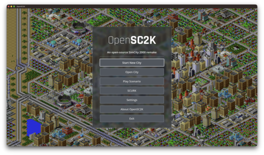
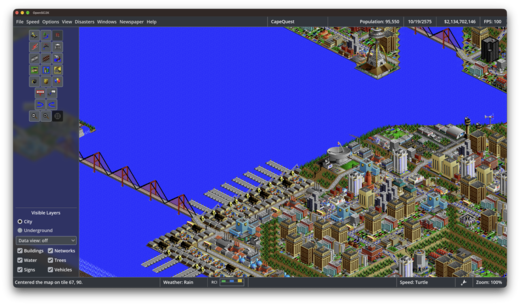
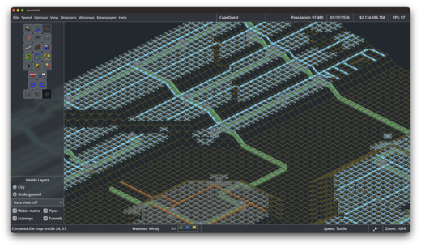
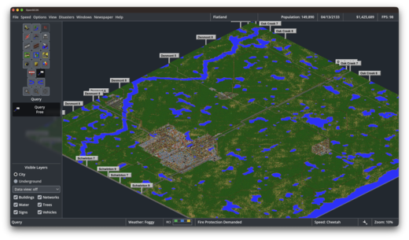
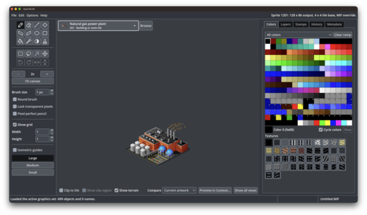
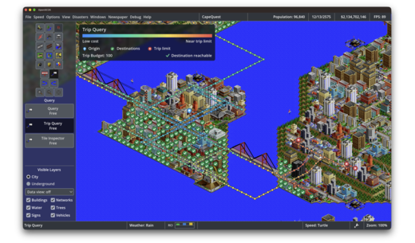
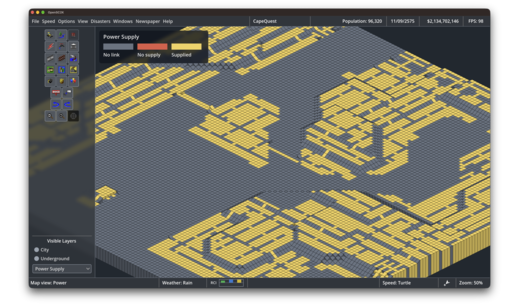
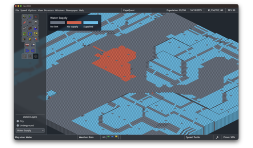
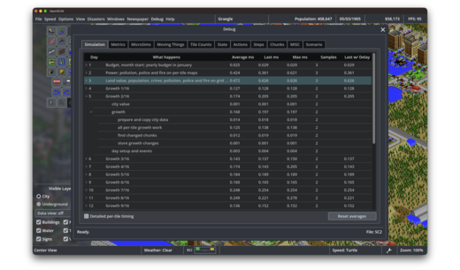

# OpenSC2K

An open-source remake of SimCity 2000, built with Rust and Godot.

Join our [Discord community](https://discord.gg/k9S6c3AqcX).

[](.github/screenshots/image1.webp)

## Screenshots

Click a thumbnail to view the full screenshot.

<p>
  <a href=".github/screenshots/image1.webp"></a>
  <a href=".github/screenshots/image2.webp"></a>
  <a href=".github/screenshots/image3.webp"></a>
  <br />
  <a href=".github/screenshots/image4.webp"></a>
  <a href=".github/screenshots/image5.webp"></a>
  <a href=".github/screenshots/image6.webp"></a>
  <br />
  <a href=".github/screenshots/image7.webp"></a>
  <a href=".github/screenshots/image8.webp"></a>
  <a href=".github/screenshots/image9.webp"></a>
</p>

## Run

Download a package from [GitHub Releases](https://github.com/nicholas-ochoa/OpenSC2K/releases).
There are packages for Windows x64 and arm64, Linux x64 and arm64, and macOS (one app for Intel and Apple Silicon).
See the [installation instructions](docs/install.md) for Windows, Linux, and macOS.
The packages include the engine. You do not need to install Godot.

You also need your own copy of SimCity 2000. See [Game files](#game-files).

To run from source:

Use Godot 4.7. The simulation, file formats, rendering, audio, and scripting are native libraries
written in Rust. Install Rust with [rustup](https://rustup.rs). `rust-toolchain.toml` selects the Rust version.

Before the first run of a fresh checkout, build the native simulation from the repository root:

```sh
python3 tools/build_native.py
```

Then run this command:

```sh
godot --headless --audio-driver Dummy --path game --editor --import
```

Wait for the command to finish. It builds the local `game/.godot` cache, including the script class index
and imported resources. Git excludes this generated folder. Without this step, a fresh checkout can show
a black screen with script errors. Opening `game/project.godot` in the Godot editor also builds the cache.

Then start the game:

```sh
godot --path game
```

## Game files

OpenSC2K does not include the original game files. They supply the original graphics, text, sound, and music.

Select **Import Assets** on the main menu, or **Settings > Import Data**. Then choose an installed game folder,
a macOS `.app`, extracted game files, or a mounted game CD-ROM. Install a GOG download before you import it.
To use a disc image file, such as an `.iso` file, mount it first.

The importer reads the Windows 95, Windows 3.x, Network Edition, DOS, and Macintosh versions, and the demos.
SimCity 2000 Special Edition for Windows 95 (1996) gives the most complete import. Some interface graphics
and the SCURK artwork come only from a complete Windows installation.
See [Import original game files](docs/media-pack-format.md#import-original-game-files).

## Extensions

- Larger cities: 256, 384, 512, 640, 1024, 2048, and 4096 tiles per side, alongside the original 128
- Smaller cities: 16, 32 and 64 tiles per side
- Updated coverage, land value, pollution, crime, and other data maps to be 1:1 resolution with the map, instead of lower resolution
- Massively increased the amount of MicroSims (XMIC) and movable objects (XTHG) that are available to be used in each city
- Improved terrain generator with configurable terrain features supported
- New isometric data views, height map, service coverage, and transport-trip overlays
- More zoom levels, layer controls, and optional dark underground views
- Debug tools: debug layers, simulation timings, and a Tile Inspector. See [Debug tools](docs/debug-tools.md)
- Support for external graphics, sound, and music packs, including an HD graphics pack. See [HD sprite packs](docs/hd-sprite-pack-format.md)
- MIDI music through FluidSynth, with the system General MIDI sound set or a SoundFont that you choose. See [FluidSynth music](docs/fluidsynth.md)
- Rebindable keyboard and mouse controls in the Controls tab of Settings
- Translated interface. Korean is the first translation
- Recent autosaves: while a changed city is open, a copy is saved each minute and kept for ten minutes
- A JavaScript runtime for mods and developer scripts, with game events, a game API, example mods in `examples/mods`, and a Chrome DevTools console. Mods load from the `mods` folder, each in its own sandbox, and the Mods tab of Settings turns them on and off. See [Scripting](docs/scripting.md) and [Mods](docs/mods.md)

Larger cities and per-tile data maps use `.sc2x` saves: ZIP archives with one raw entry per
city structure, city names of up to 64 characters, and signs that can share a tile with any
building. See [the SC2X format](docs/sc2x-format.md). The original game cannot open these
files. Original `.sc2` cities keep their separate compatibility mode until you choose
**Upgrade City to SC2X**. Older `.sc2x` files load as version 4 cities and save as a new copy.
OpenSC2K also opens and saves the `.sc2x` files that sc2kfix writes for original 128 by 128 cities.

## sc2kfix

Many fixes identified by [sc2kfix](https://github.com/sc2kfix/sc2kfix) have also
been applied or ported to this codebase. The [sc2kfix MIT notice](LICENSE)
is retained for adapted work.

## Development

Open `game/project.godot` in Godot. Run `python3 tools/build_native.py` after each change
to a crate in `native`. It also builds the FluidSynth library, which needs CMake. The validation command also builds the native libraries and runs
their unit tests. See [the native simulation](docs/native-simulation.md),
[the native region builder](docs/native-rendering.md),
[the native formats](docs/native-formats.md), [the native audio](docs/native-audio.md),
[FluidSynth music](docs/fluidsynth.md) and [the native scripting](docs/native-scripting.md) for their layouts. Run the checks with:

```sh
tools/validate_project.sh
```

The tests use silent audio. Generated city fixtures are committed. Original-data audits need `references/SIMCITY2000`; renderer and media tests can also need imported packs in `ext/`. See [fixture generation](docs/generated-city-fixtures.md).

## AI-Assisted Development

OpenSC2K is developed with the assistance of AI tools, including large language models (LLMs).
AI is used for tasks such as code generation, refactoring, research, documentation, testing, and debugging.
All architectural decisions, implementations, and contributions are reviewed and directed by the project maintainer.

See [AI-POLICY.md](AI-POLICY.md) for the project's AI usage and contribution policy.


## License

Project code is under the [MIT license](LICENSE).

Bundled [Rajdhani fonts](game/assets/fonts/rajdhani/OFL.txt) retain their own licenses.

The MIT license does not grant rights to the original game or its assets.

This project is not affiliated with or endorsed by Maxis or Electronic Arts.

OpenSC2K is an independently written re-implementation. Compatibility and simulation behavior
have been determined through observation, testing, analysis of game data, publicly available
research, and reverse engineering of the original executable.

No original SimCity 2000 source code or assets is included in OpenSC2K.
